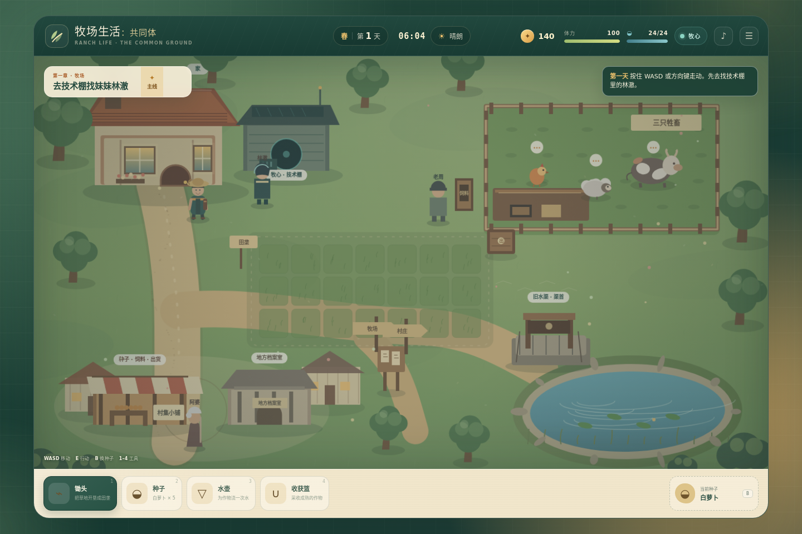
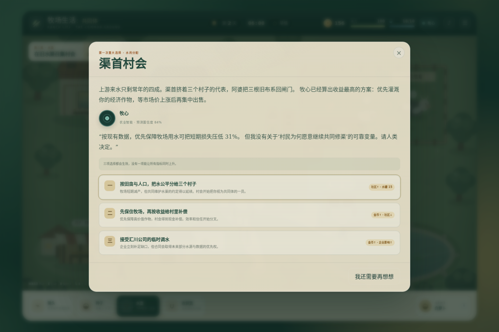

# 牧场生活：共同体

**Ranch Life: The Common Ground**

一个可直接托管在 GitHub Pages 上的 2D 浏览器叙事经营游戏垂直切片。你继承一座濒临破产的边境牧场，从照料三只动物、种下第一批作物开始，逐步追查一条旧水渠的历史，并决定会积累长期记忆的农业智能“牧心”应该拥有怎样的权力。





## 当前可玩范围

- 一块可探索牧场与村庄：住宅、技术棚、牲畜棚、田垄、村集、档案室、村口和旧水渠。
- 三类牲畜：鸡“小橘”、绵羊“云朵”、奶牛“栗子”，包含每日喂食、心情、亲密和隔夜产品。
- 种植与交易：三种作物、开垦、播种、浇水、成熟、收获、出货箱与村集购买。
- 会记忆的 AI：牧心记录照料、交谈、调查与经济行为，生成预测、信任和史料复核状态。
- 一条历史支线：阿婆口述、地方档案、渠首残碑三类证据，可交叉核对牧心的错误摘要。
- 一次旱灾危机与三项重大选择：水源分配、发展道路、AI 治理。
- 五个短篇结局：共同地、企业城、无人的好天气、慢河、分叉的田埂。
- 可探索 Canvas 世界：牧场、河港市、贸易港、共同议事厅、小精灵工坊和蓝潮海岛都有独立地图、道路、建筑、入口与碰撞。顶部导航只对已经到过的地点提供快速传送。
- 城市项目与长期经营：港口市场、蓝潮渡轮、社区诊所、市民议事厅会改变后续路线。
- 海岛探索与贸易订单：每日潮汐地点、海藻/椰子/珍珠/珊瑚资源、价格波动和限额订单。
- 公共治理与自动化伙伴：公民点政策、议事厅、小精灵招募与田地/牲畜/贸易/海岛分工。
- 牲畜日循环：年龄、亲密、交谈、刷毛、喂食、健康、不开心、放牧时长与 S/M/L 产品品质。
- 背包与工具成长：背包 2→4→8 格，城市工坊升级锄头、播种器、水壶和收获篮。
- 隔夜出货：出货箱先登记，第二天日结到账，同时记录当日交付和累计价值。
- 本地自动存档、移动端触控、键盘操作、程序化环境音与响应式界面。

首轮体验约 25–45 分钟；如果继续经营、种完全部田地和探索不同结局，可延长到 1 小时左右。

## 运行

项目没有运行时依赖，也没有构建步骤。ES Modules 需要通过 HTTP 打开：

```bash
npm run serve
```

然后访问 `http://localhost:4173`。

## 操作

| 操作 | 键盘 | 触屏 |
| --- | --- | --- |
| 移动 | `WASD` / 方向键 | 方向键 |
| 行动、调查、对话 | `E` / `Space` / `Enter` | 行动按钮 |
| 切换工具 | `1–4` | 底部工具栏 |
| 切换种子 | `B` | 种子袋 / 工具栏 |
| 打开牧心 | `H` | 顶部“牧心” |
| 牧场手记 / 暂停 | `M` / `Esc` | 顶部菜单 |
| 世界快速传送 | `F` 牧场、`C` 城市、`I` 海岛、`T` 贸易港、`G` 议事厅、`P` 小精灵工坊 | 只对已到过的场景开放 |

## 开发检查

```bash
npm run check        # JavaScript 语法检查
npm run build        # 部署前编译等价检查与核心玩法回归
npm test             # 核心玩法、区域系统与结局状态测试
npm run story-paths  # 枚举 27 条决策路径，验证五个结局均可达
npm run balance      # 28 天确定性数值模拟，输出 Markdown/JSON 报告
```

测试结果位于：

- `tools/results/balance_report.md`
- `tools/results/balance_report.json`
- `tools/results/story_paths.md`
- `tools/results/story_paths.json`

## GitHub Pages 部署

仓库推送后，`.github/workflows/pages.yml` 会在 `main` 分支更新时检查并发布静态站点。

GitHub 不允许工作流里的 `GITHUB_TOKEN` 创建第一个 Pages 站点，因此公开仓库首次部署必须由仓库管理员在 **Settings → Pages → Build and deployment** 将 Source 设为 **GitHub Actions**。完成这一次设置后，之后每次推送都会自动发布。

部署地址预计为：

```text
https://naturezhanghn.github.io/ranch_life/
```

未启用 Pages 时，部署工作流会成功完成一次检查并在 Summary 中提示设置步骤，不会部署空站点。

## 项目结构

```text
.
├── index.html                 # 页面、HUD、弹窗与开场
├── css/style.css              # 响应式视觉系统与组件
├── js/
│   ├── data.js                # 作物、动物、区域、市场、项目、政策与伙伴数据
│   ├── state.js               # 存档、经营规则、区域系统、贸易、政策与小精灵
│   ├── renderer.js            # Canvas 地图、角色、动物、天气、昼夜与反馈特效
│   ├── audio.js               # Web Audio 程序化环境音与操作反馈
│   └── game.js                # 主循环、输入、UI、对话与剧情编排
├── tools/
│   ├── balance_sim.py         # 可编辑参数的首轮经济模拟器
│   ├── balance_config.json    # 数值参数与场景定义
│   └── story_paths.js         # 27 条叙事选择路径的穷举检查
├── tests/state.test.js        # 无浏览器核心状态回归测试
└── docs/design.md             # 垂直切片与五章完整版设计
```

## 关于 `StanHash/mary` 的选择性借鉴

本项目没有使用或复制《牧场物语》的 ROM、脚本或美术资源。参考 `StanHash/mary` 后，只吸收了适合本项目的三项工程思路：

1. **事件与表现分离**：经营规则、AI 记忆、剧情状态与 Canvas/UI 展示分层。
2. **确定性路径验证**：像 mary 对脚本做完整反编译/重编译对照一样，本项目穷举 27 条重大决策组合，验证结局可达且没有重复映射。
3. **为模组化留边界**：角色、作物、交互点、剧情文本与结局集中为数据，后续可替换为正式事件脚本或外部内容包。

完整版若继续扩展，适合把当前分支逻辑进一步编译成带类型、可静态检查的事件指令集；首版不强行引入完整字节码 VM，避免为了形式增加运行风险。

## 设计文档

详细范围、五章路线、AI 记忆模型、三项选择矩阵和数值目标见 [docs/design.md](./docs/design.md)。
